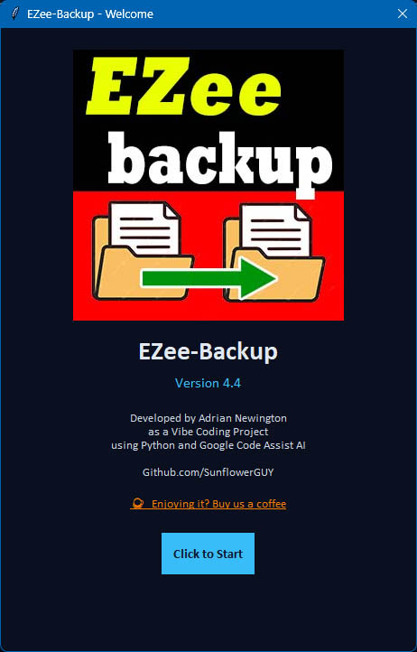
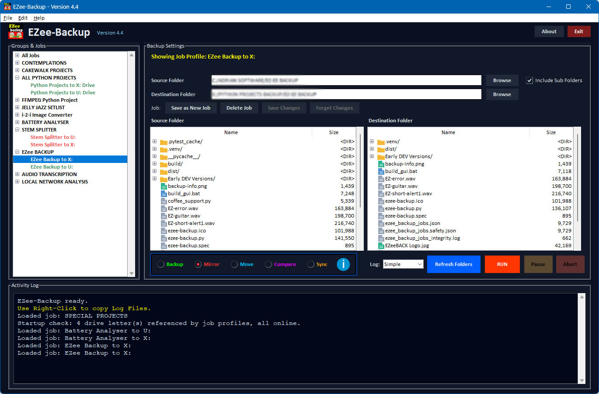

# EZee-Backup

EZee-Backup is a lightweight Windows backup tool designed for fast, repeatable folder-to-folder operations. It uses ROBOCOPY under the hood to copy, synchronize, move, or compare directories from a simple dark-themed desktop interface.

The app is built for users who want a no-fuss way to back up important folders without needing Python installed on the target machine. It supports saved jobs, grouped job profiles, source and destination browsing, logging modes, and a portable EXE build for easy deployment.

## Screenshots





## Features

- Portable Windows desktop app built with PyInstaller.
- Dark-themed Tkinter interface tailored for local backup workflows.
- Backup, Sync, Move, and Compare modes backed by Windows `ROBOCOPY`.
- Source and Destination folder selectors with visible file/folder listings.
- Saved jobs with named groups, job selection, duplication, renaming, and deletion.
- Jobs are stored in `ezee_backup_jobs.json` beside the executable when bundled, or in the project folder when running from source.
- Simple, Verbose, and No Logs output modes for the command stream.
- Pause and Abort controls while a backup job is in progress.
- Splash screen, app icon, and built-in completion/error sounds.
- Right-click log actions for copying selected text, copying the full log, opening it in Notepad, or clearing the log.
- Windows-only behavior: the app expects `ROBOCOPY` and normal Windows file permissions to be available.

## Backup Modes

### Backup

Copies files from the source folder to the destination folder. Existing destination files are updated as needed.

### Mirror

Mirrors the source and destination using `ROBOCOPY /MIR`. This can remove destination files that no longer exist in the source, so use it carefully.

### Move

Copies files and removes them from the source using the move mode settings.

### Compare

Performs a listing-only comparison using `ROBOCOPY /L`. No files are changed.

## Requirements

### To run the compiled application

- Windows 10 or later is recommended.
- Windows `ROBOCOPY` must be available.
- No Python installation is required to run the compiled executable.

### To build from source

- Windows.
- Python 3.10 or newer.
- Python's Tkinter support.
- Internet access for installing Python packages.

Python 3.10 or newer is required because the source uses modern type annotation syntax.

## Building the Application

The repository includes `build_gui.bat` for a repeatable Windows build.

1. Close every running copy of EZee-Backup.
2. Open the project folder.
3. Double-click `build_gui.bat`, or run it from Command Prompt.
4. The compiled application will be created at:

```text
dist\EZee-Backup.exe
```

The build script:

- Locates Python 3.
- Installs packages listed in `requirements.txt`.
- Runs the test suite.
- Checks required source and asset files.
- Cleans previous `build` and `dist` folders.
- Runs PyInstaller using `ezee-backup.spec`.
- Detects a running executable before attempting to overwrite it.

The PyInstaller specification bundles the application icon and logo assets into the executable build.

## Manual Build

To build manually from a Python environment:

```powershell
python -m pip install -r requirements.txt
python -m pytest -q
python -m PyInstaller --clean --noconfirm ezee-backup.spec
```

The result is written to `dist\EZee-Backup.exe`.

## Running From Source

Install the dependencies and start the application with:

```powershell
python ezee-backup.py
```

## Using EZee-Backup

1. Start the application.
2. Choose a saved job from the Job dropdown, or select source and destination folders manually.
3. Use `Browse` to select the Source Folder.
4. Use `Browse` to select the Destination Folder.
5. Review the visible folder panes.
6. Select a backup mode.
7. Optionally enable Verbose Logging.
8. Click `RUN`.

Use Compare before a destructive synchronization when you need to inspect the expected operation first.

## Log Actions

Right-click inside the Activity Log panel to access quick clipboard and file actions:

- `Copy Selected` copies only the currently highlighted log text.
- `Copy Logs` copies the full log output to the clipboard.
- `Copy Logs and Launch NOTEPAD` saves the current log to a temp file and opens it in Notepad.
- `Clear Log` resets the panel back to the default ready message.

This is useful for saving backup output, raising a support issue, or quickly copying the result of a previous operation.

## Understanding Robocopy Log Entries

The Activity Log shows the raw output from Windows `ROBOCOPY`, so a few status words are helpful to understand:

- `Same` means the source file and destination file already match. Nothing needs to be copied.
- `Added` or `New File` style entries mean the file was copied because it did not exist in the destination.
- `Updated` or `Changed` entries mean the destination version differed and was replaced.
- `Skipped` usually means the file was not processed for a reason such as an access issue, a locked file, or a path problem.

So in normal use, `Same` is not an error or a failed copy. It is just Robocopy confirming that no action was required.

## Project Files

| File | Purpose |
| --- | --- |
| `ezee-backup.py` | Main application source. |
| `ezee-backup.spec` | PyInstaller build specification. |
| `build_gui.bat` | Windows build script for reproducible EXE builds. |
| `requirements.txt` | Python runtime and packaging dependencies. |
| `test_app.py` | Automated tests for core backup logic and job persistence. |
| `EZeeBACK Logo.jpg` | Splash/logo image used in the app UI. |
| `ezee-backup.ico` | Windows application icon for the EXE. |
| `backup-info.png` | Small informational icon used in the UI. |
| `EZ-guitar.wav` | Completion sound played after successful work. |
| `EZ-error.wav` | Error sound used for failed or aborted work. |
| `ezee_backup_jobs.json` | Saved backup jobs file created next to the executable at runtime. |

## Testing

Run the tests with:

```powershell
python -m pytest -q
```

The tests cover core command construction, job persistence, executable-directory job storage, and the application version.

## Windows 10 Deployment Checklist

Use this checklist before installing or distributing EZee-Backup on a Windows 10 PC.

- Windows 10 or newer is supported.
- `ROBOCOPY` must be available on the target machine.
- Confirm the command works in Command Prompt:

```cmd
robocopy /?
```

- Check permission to read the source folder.
- Check permission to write to the destination folder.
- Ensure the source and destination paths exist and are valid folders.
- Avoid protected or locked-down locations unless the user has the required rights.
- Do not point the source and destination at the same folder.
- Ensure external drives or network shares are connected and mapped correctly.
- Verify no file locks are blocking the backup process.
- Run the app under a normal user session with valid access to both folders.
- Test a simple copy manually before relying on the backup tool:

```cmd
robocopy "C:\SampleSource" "D:\BackupTarget" /E
```

If `robocopy` runs successfully in Command Prompt, the Windows environment is generally suitable for EZee-Backup.

Common issues are permission problems, invalid paths, locked files, or restricted corporate policies rather than app-level incompatibility with Windows 10.

## Safety Notes

- Always verify Source and Destination before clicking `RUN`.
- `Sync` uses mirror behavior and may remove files from the destination.
- Use `Compare` to preview the expected copy operation first.
- Keep independent backups of important data.

## License

No license has been specified for this project yet. Add a license file before accepting or encouraging external redistribution.
